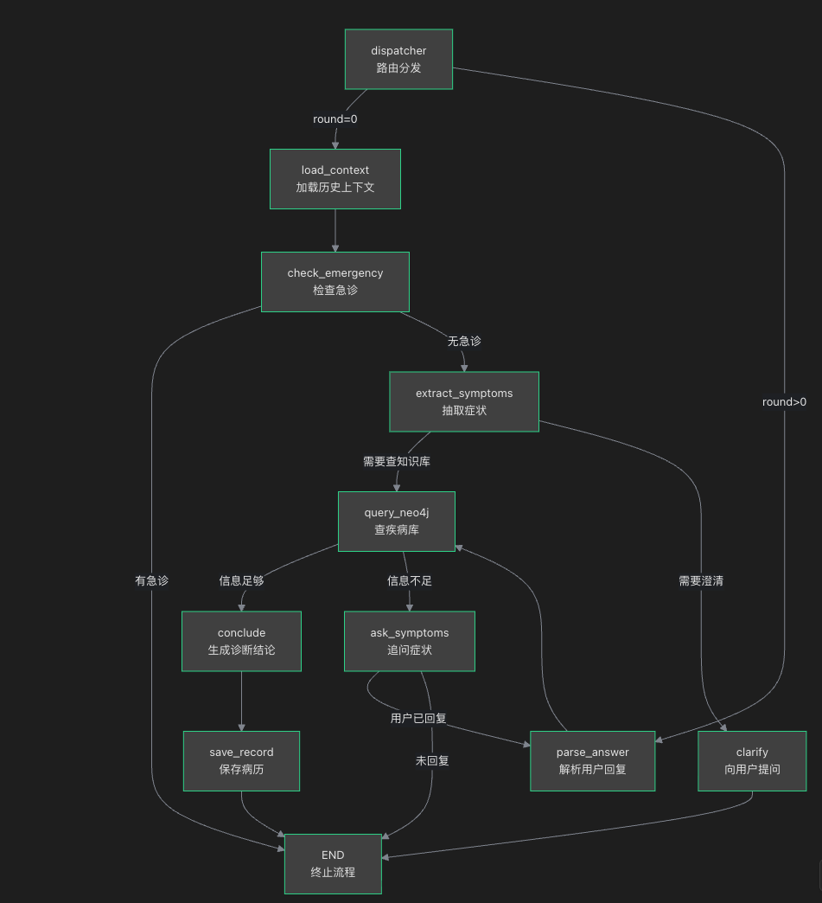

# his-agent-platform

#### 介绍
《医疗-智能体》集中于解决医疗领域的 Agent 业务构建。包括：
1. 智慧问诊 Agent
2. 报告解读 Agent
3. 药物 Agent
4. 知识文档 Agent
5. 运营数据 Agent

#### 软件架构

采用前后端分离架构：后端 FastAPI 提供 `/api/v1` REST + SSE 流式接口，上层由 Supervisor Agent 统一路由，
下辖问诊 / 报告解读 / 药物 / 知识文档 / 运营数据五个 Worker Agent；前端为 pnpm workspace 管理的两个
Vite + React 站点（患者端、管理端），通过 `shared` 包复用类型、API Client 与 SSE 解析逻辑。

```
浏览器（患者端 / 管理端）──REST + SSE──▶ FastAPI（src/）
                                          ├── Supervisor Agent（意图路由）
                                          │     └── Worker Agents（问诊 / 报告 / 药物 / 知识 / 运营）
                                          ├── RAG（文档 / 图谱 / NL2SQL / 融合检索）
                                          └── PostgreSQL · Redis · Milvus · Neo4j · RustFS
```

#### 后端技术栈

| 分层 | 技术选型 | 说明 |
| --- | --- | --- |
| 语言 / 运行时 | Python 3.13 | 全异步 `asyncio` |
| Web 框架 | FastAPI 0.135 + Starlette + Uvicorn | REST 接口；`/api/v1` 路由前缀 |
| 流式输出 | 手写 SSE（`StreamingResponse`） | 对话流式返回，带 seq 序号与心跳帧，支持断连取消 |
| 数据校验 / 配置 | Pydantic 2.12 + pydantic-settings | schemas 校验；配置从 `.env` 加载 |
| ORM / 数据库 | SQLAlchemy 2.0（async）+ asyncpg + PostgreSQL | 异步会话 `AsyncSession` |
| 数据库迁移 | Alembic | 版本文件在 `alembic/versions/` |
| Agent 编排 | LangChain 1.2 + LangGraph 1.1 | Worker 用 `create_agent`（ReAct）；问诊为自研 `StateGraph` 状态机 |
| 会话持久化 | langgraph-checkpoint-redis（`AsyncRedisSaver`）+ 自研 `MilvusStore` | 短期记忆存 Redis，长期记忆落 Milvus |
| LLM 接入 | langchain-openai（`ChatOpenAI`） | DeepSeek / OpenAI 兼容协议经 `base_url` 接入，带模型故障转移链 |
| 向量检索 | Milvus（pymilvus 2.6）+ OpenAI 兼容 Embedding | COSINE + IVF_FLAT；RAG 四通道：文档 / 图谱 / NL2SQL / 融合 |
| 精排 | dashscope Rerank | 检索结果二次排序 |
| 知识图谱 | Neo4j（`neo4j` 5.28 官方驱动） | 疾病 - 症状 - 药物 - 科室关系 |
| 缓存 / 队列 | Redis（redis-py 7.3 async） | 业务缓存、Agent checkpoint、限流计数、批量落库队列 |
| 对象存储 | RustFS（S3 兼容，boto3 访问） | 报告 / 知识文档等文件存储 |
| 鉴权 | PyJWT + OAuth2 Bearer | 患者端与 Admin 端两套登录态 |
| 限流 | Redis 滑动窗口 + SSE 并发闸门 | `src/api/rate_limit.py`、`src/core/concurrency.py` |
| 日志 / 监控 | loguru + 自定义 `LoggingMiddleware`；Sentry（可选，上报前剥离 PHI） | `/health`、`/health/deps`、`/metrics`（Prometheus 格式） |
| 测试 | pytest + pytest-asyncio | 单测默认不连外部服务，集成用例用 `-m integration` |

#### 前端技术栈

| 分层 | 技术选型 | 说明 |
| --- | --- | --- |
| 语言 | TypeScript 5.6 | 两个站点均开启严格类型检查（`tsc -b`） |
| 框架 | React 18.3 + React Router 6.28 | SPA，前端路由 |
| 构建工具 | Vite 5.4 + `@vitejs/plugin-react` | 患者端 5173、管理端 5174，dev 代理 `/api` 到后端 |
| 样式 | Tailwind CSS 3.4 + PostCSS + Autoprefixer | 原子类样式 |
| 组件 / 图标 | lucide-react、framer-motion（动效）、clsx | 轻量自研组件，无重型 UI 库 |
| 数据可视化 | recharts（管理端图表）、react-big-calendar（患者端预约日历）、react-virtuoso（长列表虚拟滚动） | 按端按需引入 |
| 日期 / 工具 | dayjs | 时间格式化 |
| 流式对话 | `fetch` + `ReadableStream` 自研 SSE 解析（`shared/src/sse/streamChat.ts`） | 支持 `AbortSignal` 中断、seq 重连 |
| 状态管理 | React Context + Hooks（无 Redux / Zustand） | 会话态、Admin 登录态 |
| 语音输入 | 浏览器 Web Speech API + MediaRecorder | 实时转写，暂未接后端 ASR |
| 包管理 | pnpm workspace（`shared` / `patient` / `admin` 三包） | `shared` 以源码形式被两端复用 |

#### 安装教程

```sh
# 创建环境
conda create -n his-agent python=3.13

# 激活环境
conda activate his-agent

# 安装依赖
pip install -r requirements.txt
```

## 指定端口启动
```
uvicorn src.main:app --port 8080 --reload
```

## env配置
把 .env.example 复制一份 叫 .env ，修改为自己的信息即可

## 用户名密码
各中间件（PostgreSQL / Redis / Milvus / Neo4j / RustFS）的地址与凭证一律配在 `.env` 中，
不写入仓库、不写在文档里 —— 仓库只维护 `.env.example` 模板。

本地起服务：

```sh
his-agent-platform-docker compose -f doc/his-agent-platform-docker-compose.yml up -d
alembic upgrade head
python scripts/init_postgres.py
```

## 测试
```sh
# 默认只跑确定性单测（不连 LLM / 数据库，可在任何机器上运行）
pytest

# 依赖真实外部服务的集成用例，需要 .env 与本地依赖就绪后单独执行
pytest -m integration
```

# 数据库配置以及迁移框架
- 数据库：PostgreSQL
- 虚拟环境使用conda，不要用venv 
- 数据库迁移框架：Alembic

### Alembic操作步骤
cd his-agent-platform

1. 初始化 Alembic环境
alembic init alembic

2. 生成迁移文件（检测 model.py 变化）
alembic revision --autogenerate -m "init medical schema"

3. 执行迁移，建表
alembic upgrade head

4. 降级到上一个版本
alembic downgrade -1`

5. 降回指定版本
alembic downgrade 000000000000
> 版本id是alembic下version目录下每个文件的id

6. 查看所有迁移记录
alembic history

7. 查看当前数据库版本
alembic current
> 注意：需要先在 `alembic/env.py` 中导入 medical model，让 Alembic 能检测到表定义：
> from src.modules.medical.model import *  # 在 target_metadata 之前添加

8. 创建后台管理员用户
python scripts/create_admin.py admin/root 123456/admin12345
9. 重置管理员密码
python scripts/create_admin.py admin 123  --reset

### 数据导入
1. 导入 medical.json 数据
python scripts/init_postgres.py

## 多agent 业务构建

### 智慧问诊 Agent


# 前端
## 项目介绍
患者端 + 管理端双站点，技术栈见上方「前端技术栈」。目录结构：

```
front/
├── shared/     # 复用包：类型定义、API Client、SSE 解析、常量（源码直引）
├── patient/    # 患者端：对话、历史、预约日历、语音输入
└── admin/      # 管理端：Dashboard、知识库、模型配置、Token 用量、Traces
```

## 启动命令
``` shell
cd front
pnpm install     # workspace 安装三包依赖（Node >= 18）
npm run dev:p    # 患者端 http://localhost:5173
npm run dev:a    # 管理端 http://localhost:5174
npm run build    # 全部构建

# 单独构建
npm run build:patient
npm run build:admin
```